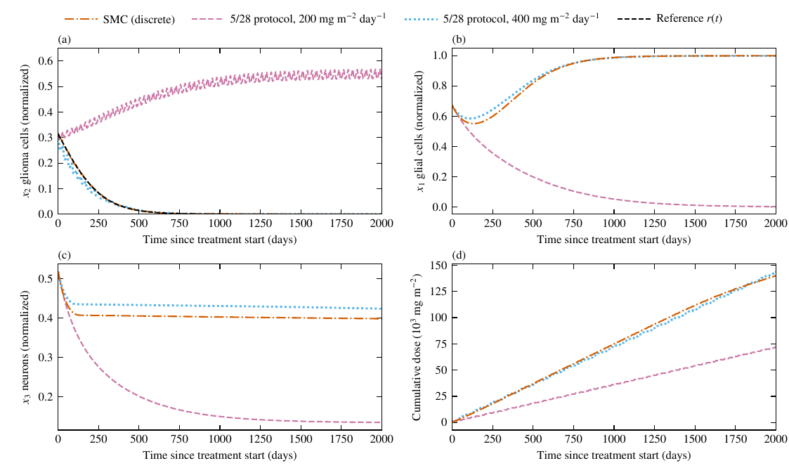
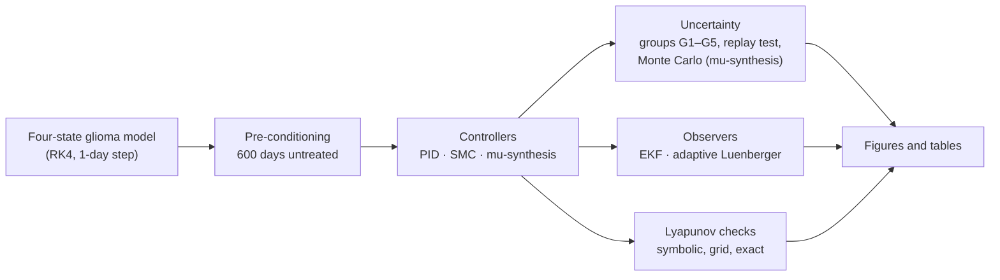

# Robust drug scheduling for glioma chemotherapy based on a multivariable dynamic model and state estimation via an extended Kalman filter

[](LICENSE)


Code and stored results for the article by **Saeed Rahimi** and **Hamed Moradi** (corresponding author),
Sharif University of Technology, Tehran, Iran. Submitted to *Computer Methods and Programs in Biomedicine*.

A four-state model of glioma growth (glial cells x1, glioma cells x2, neurons x3, drug concentration x4) is
used to design chemotherapy schedules by feedback control. Three controllers (a gain-scheduled PID, a
sliding-mode controller and a mu-synthesis controller) choose each day a dose of 50 or 200 mg m^-2 so that
the tumor population follows a smooth reference over 2000 days. The schedules are compared with a
maximum-dose baseline and the standard 5/28 protocol, tested under parameter uncertainty and with state
observers, and backed by a Lyapunov analysis. Every result in the paper can be regenerated from the scripts
here, and the stored outputs are included so that a new run can be checked against them.



*Discrete SMC schedule versus the 5/28 protocol at 200 and 400 mg m^-2 day^-1: (a) glioma cells, (b) glial
cells, (c) neurons, (d) cumulative dose (from `figures/main/fig_protocol_comparison_4panel_v2.pdf`).*

## Results at a glance

Nominal model, 2000 days of treatment (day 0 = start of treatment), values as printed in the paper.

**How to read this table.** The maximum-dose baseline is a reference bound, not a treatment option. It
gives 200 mg m^-2 every day for 236 days in a row, which breaks the dosing rule that the controllers obey
(each day either 50 or 200 mg m^-2, and no high-dose phase longer than 5 days). Once x2 < 1e-4 it stops the
drug and sets the tumor to zero by assumption, so its x2(T) = 0 follows from this rule. Its early
suppression, small cumulative dose and high x3(T) therefore mark the best values this model allows, and the
controllers are measured against them. The controllers keep to the admissible dosing, reach x2 < 1e-4
within two days of each other, and follow a planned reference trajectory: the suppression day is set by
that reference, not by a dose limit. No controller is best on every metric: PID uses the least drug, SMC
tracks the reference most closely and mu-synthesis leaves the smallest final tumor. The standard 5/28
schedule does not control the tumor at 200 mg m^-2 in this model; at 400 mg m^-2, above the admissible
range, it does.

| schedule | first day with x2 < 1e-4 | x2(T) | x3(T) | cumulative dose (mg m^-2) | glial recovery to 99% (day) | longest high-dose phase (days) |
|---|---|---|---|---|---|---|
| maximum-dose baseline (bound, breaks the dosing rule) | 236 | 0 | 0.48 | 47200 | 664 | 236 |
| PID | 1166 | 1.58e-5 | 0.40 | 131350 | 1042 | 4 |
| SMC | 1165 | 2.05e-6 | 0.40 | 140050 | 1042 | 4 |
| mu-synthesis | 1167 | 1.25e-6 | 0.39 | 142150 | 1046 | 5 |
| 5/28 protocol, 200 mg m^-2 | not reached | 0.53 | 0.13 | 72000 | – | – |
| 5/28 protocol, 400 mg m^-2 (above the admissible range) | 1272 | 8.25e-7 | 0.42 | 144000 | – | – |

Sources: `results/tables/paper/controller_summary_rows.tex` (baseline, PID, SMC, mu-synthesis) and
`results/tables/T_protocol_comparison.tex` (5/28 protocol; glial recovery and phase length are not stored
for it). Details of the baseline rule are in [Notes](#notes).

## Method in one picture



## Contents

- [Requirements](#requirements)
- [Reproduce](#reproduce)
- [Repository layout](#repository-layout)
- [Figures and tables](#figures-and-tables)
- [Notes](#notes)
- [Related work](#related-work)
- [How to cite](#how-to-cite)
- [License and contact](#license-and-contact)

## Requirements
- Python 3.13 with the pinned packages in `requirements.txt`:

      pip install -r requirements.txt

- MATLAB R2023a with the Robust Control, Control System and Statistics and Machine Learning toolboxes,
  for the mu-synthesis part only (see [MATLAB.md](MATLAB.md)).

## Reproduce
Run from the repository root. Measured on a Windows 11 laptop (Python 3.13.0) in one verification run;
times are wall-clock.

| step | command | time |
|---|---|---|
| pre-conditioning | `python model/simulation_preconditioning.py` | 3 s |
| maximum-dose baseline | `python model/baseline_max_dose.py` | 4 s |
| metrics of the baseline | `python model/baseline_metrics.py` | 1 s |
| PID | `python controllers/pid/pid_simulation.py` | 5 s |
| SMC, continuous SMC, 5/28 protocol | `python controllers/smc/smc_simulation.py` | 9 s |
| E1 for PID (after the PID run) | `python uncertainty/pid_uncertainty.py` | 4 s |
| E1 for SMC (after the SMC run) | `python uncertainty/smc_uncertainty.py` | 4 s |
| observers (after the PID and SMC runs) | `python observer/observer.py` | 282 s (11 worker processes) |
| observer summary | `python observer/make_facts_block.py` | 3 s |
| Lyapunov certificate | `python lyapunov/verify_proof_symbolic_and_grid.py` | 4 s |
| sign condition of the certificate in exact arithmetic | `python lyapunov/verify_lemma_exact.py` | 1 s |
| full proof of the Lyapunov result (long version of Appendix A) | `lyapunov/full_proof.tex` | - |
| dW/dt along the runs | `python lyapunov/verify_proof_plots.py` | 7 s |
| tracking-error bounds | `python lyapunov/error_dynamics.py` | 2 s |
| all figures | `python figures/make_figures.py` | 17 s |
| baseline, 5/28, replay, observer and Lyapunov figures | `python figures/make_figures_v2.py` | 30 s |
| tables of the paper | `python tables/build_protocol_table.py`, `python tables/build_lyapunov_groups_v2.py`, `python tables/make_table_controller_summary.py`, `python tables/make_tables_observer.py`, `python tables/make_tables_mu_tests.py` | a few seconds |
| tuning (not needed to reproduce the results) | `python tuning/tune_pid_smc.py` | 161 min (authors' run) |
| mu-synthesis (MATLAB) | see [MATLAB.md](MATLAB.md) | 309.5 min for the full search (authors' run); CSV export 125 s |

The scripts write their CSV files to `results/runs/` and their own diagnostic plots to
`results/diagnostic_plots/`; the figures of the paper come only from `figures/make_figures.py`, which reads
`results/figure_data/`. Every Python script was run from this layout and its output compared with the
original output: all numbers agree to 1e-10 (relative), most files byte for byte. The tuning search
itself was not repeated; its objective was re-evaluated at the hand design and at the selected parameters
and agrees with the stored history.

Conventions: day 0 is the start of treatment (simulation day 600). Threshold for x2: 1e-4. Cumulative dose
= sum of the daily doses on days 0..1999. The maximum-dose baseline gives u = 200 until the first day with
x2 < 1e-4 (day 236); from that day on x2 := 0 and u = 0. The continuous SMC, which is not used in the paper,
stops at x2 <= 1e-5 (a stopping criterion of the code, then x2 := 0 and u = 0).

## Repository layout
| folder | content |
|---|---|
| `model/` | pre-conditioning, maximum-dose baseline, `glioma_paper/` (model, replay of a dose schedule, the metric function used for every table) |
| `controllers/pid/`, `controllers/smc/` | nominal discrete PID; discrete SMC, continuous SMC and the standard 5/28 protocol |
| `controllers/mu_synthesis/` | MATLAB design and weight search, results file, caches, CSV exports ([MATLAB.md](MATLAB.md)) |
| `tuning/` | differential-evolution tuning of PID and SMC |
| `uncertainty/` | protocol E1: nominal PID and SMC schedules replayed on G1..G5 (mu: `mu_py_timeseries.csv`, mode E1_replay) |
| `observer/` | observer study (EKF, Luenberger) and the script that summarizes its results |
| `lyapunov/` | symbolic and grid check of the Lyapunov certificate, the same sign check in exact rational arithmetic, dW/dt along the simulated runs, tracking-error bounds |
| `figures/` | `make_figures.py` (pre-conditioning, PID gains, sliding band, schedules, states, drug concentration, appendix figures) and `make_figures_v2.py` (baseline, 5/28 comparison, replay test, observers, Lyapunov function; written to `figures/main/*_v2.pdf`) |
| `tables/` | scripts that write the rows of the tables of the paper to `results/tables/paper/` (two-decimal formatting in `tables/fmt.py`) |
| `results/` | `tables/` (CSV and LaTeX of every table), `figure_data/` (the data behind every figure) |
| `data/` | consolidated outputs of the runs: `metrics_all.csv` (read by `tables/build_protocol_table.py`, `tables/make_table_controller_summary.py` and `tables/extract_numbers.py`), the MATLAB metric exports, the observer summaries and cross-check files; the remaining files are uncompressed copies of `results/figure_data/` |
| `assets/` | the PNG shown at the top of this README |

## Figures and tables
| item | script | data |
|---|---|---|
| model schematic | TikZ in the manuscript | - |
| `fig_preconditioning` | figures/make_figures.py | preconditioning.csv (model/simulation_preconditioning.py) |
| `fig_baseline_v2` | figures/make_figures_v2.py | baseline_max_dose.csv (model/baseline_max_dose.py, model/baseline_metrics.py) |
| `fig_schedules`, `fig_states`, `fig_x4` | figures/make_figures.py | nominal_discrete.csv (PID, SMC, mu runs) |
| `fig_pid_gains` | figures/make_figures.py | pid_gain_schedule.csv (controllers/pid) |
| `fig_smc_band` | figures/make_figures.py | smc_sliding_band.csv (controllers/smc) |
| `fig_continuous` | figures/make_figures.py | nominal_continuous.csv (controllers/smc, mu_synthesis) |
| `fig_uncertainty_v2` | figures/make_figures_v2.py | e1_uncertainty.csv (uncertainty/, mu E1) |
| `fig_protocol_comparison_v2` (one panel, used in the paper), `fig_protocol_comparison_4panel_v2` | figures/make_figures_v2.py | standard_protocol.csv, nominal_discrete.csv (controllers/smc) |
| `fig_observer_M1_stacked_v2`, `fig_observer_noise20_stacked_v2`, `fig_observer_mismatch_stacked_v2` | figures/make_figures_v2.py | observer/results/ (observer/observer.py); the noise figure recomputes the 20 noise sequences with the functions of observer.py |
| `fig_lyapunov_W_dW_v2`, `fig_lyapunov_G5_SMC_v2` | figures/make_figures_v2.py | lyapunov_W_timeseries.csv (lyapunov/verify_proof_plots.py) |
| `fig_app_tuning` | figures/make_figures.py | tuning_convergence.csv (tuning/) |
| `fig_app_mu_search`, `fig_app_mu_E2_mc`, `fig_app_mu_rules` | figures/make_figures.py | mu_*.csv (controllers/mu_synthesis) |
| `fig_app_lyapunov` | figures/make_figures.py | lyapunov_W_timeseries.csv (lyapunov/verify_proof_plots.py) |
| main tables (`T_main_continuous`, `T6_uncertainty`) | metric function in model/glioma_paper/metrics.py | results/tables/ |
| tables as printed in the paper (metrics of the controllers, replay test, observers, mu-synthesis tests, 5/28 comparison, Lyapunov groups) | tables/*.py | results/tables/paper/, `T_protocol_comparison`, `T_lyapunov_groups_v2` |
| `T_observer`, `T_app_observer_*` | observer/observer.py | results/tables/ |
| `T_design_pid`, `T_design_smc`, `T_app_tuning_runs` | controllers/pid, controllers/smc, tuning/ | results/tables/ |
| `T_design_mu`, `T_app_mu_*` | controllers/mu_synthesis | results/tables/ |
| `T_lyapunov`, `T_app_lyapunov_groups` | lyapunov/ | results/tables/ |

`results/figure_data/` was assembled from the outputs of the scripts above (long format, one file per
figure family); the larger files are stored gzipped and are read as they are.

## Notes

### Stored results
- Baseline: `model/baseline_max_dose.py` stops the drug on the first day with x2 < 1e-4, the suppression
  threshold of the paper. The run stops on day 236, with a cumulative dose of 47200 mg m^-2, x3(T) = 0.476 and
  glial recovery on day 664 (`results/tables/baseline_metrics_v2.json`, written by `model/baseline_metrics.py`).
- The baseline row of `data/metrics_all.csv` was updated from `baseline_metrics_v2.json`. The tables printed
  in the paper are in `results/tables/paper/`.
- `figures/make_figures_v2.py` uses the style settings of `make_figures.py`. Its observer figures read
  `observer/results/`, and its noise figure recomputes the 20 noise sequences with the functions of
  `observer/observer.py`.
- A new run of `controllers/smc/smc_simulation.py` and of the three scripts in `lyapunov/` reproduces the stored
  outputs to 1e-10 (relative).

### Scripts and results not used in the paper
- The continuous SMC in `controllers/smc/smc_simulation.py` (`nominal_continuous.csv`, `fig_continuous`).
- The closed-loop runs of the discrete SMC on the perturbed plants G1 to G5 in `lyapunov/verify_proof_plots.py`
  (protocol `closed_loop` in `lyapunov_wdot_summary.csv`). They were made only to evaluate the Lyapunov function;
  their dose and phase metrics were not computed. In the paper, PID and SMC are evaluated on the perturbed
  plants by the replay test only.
- The appendix figures of `figures/make_figures.py` (`fig_app_*`).

## Related work
[glioma-neural-surrogate](https://github.com/Saeeedr74/glioma-neural-surrogate): LSTM and Transformer
surrogates of the same glioma model.

## How to cite
Please cite the article (see also [CITATION.cff](CITATION.cff)):

```bibtex
@article{rahimi_moradi_glioma_scheduling,
  author  = {Rahimi, Saeed and Moradi, Hamed},
  title   = {Robust drug scheduling for glioma chemotherapy based on a multivariable dynamic model and state estimation via an extended Kalman filter},
  journal = {Computer Methods and Programs in Biomedicine},
  note    = {Submitted},
  doi     = {TODO}
}
```

## License and contact
MIT License ([LICENSE](LICENSE)).

Contact: saeed.rahimi74@sharif.edu
